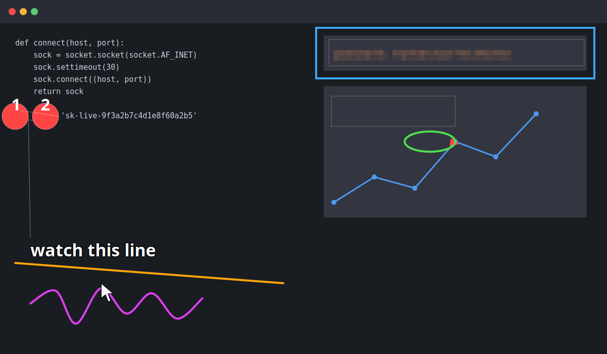

# Quickshot

Press **Super+Shift+S** (or **Print**). Drag a region. Annotate it. Press **Enter**.

The image is on your clipboard and the editor is gone.



## Why this exists

Most screenshot tools on Linux fall into one of two failure modes: they replace
the native capture flow with their own (so the muscle memory you already have
stops working), or they keep the native flow but bolt an editor on afterwards
that is slow to appear and awkward to drive.

Quickshot keeps the part you already like and replaces only the part that isn't
good enough. Capture goes through the XDG desktop portal, which on GNOME is the
*exact same* drag-to-select overlay that PrintScreen already gives you — same
feel, same keyboard, same muscle memory. What changes is the destination: the
result lands in an editor that is already built and waiting, so there is no
launch delay and no second screenshot tool to learn.

## Install

```sh
./install.sh
```

No root required. Installs to `~/.local/share/quickshot`, registers a systemd
user service, and binds the hotkeys.

To choose your own hotkeys:

```sh
./install.sh '<Super><Shift>s' '<Ctrl><Alt>s'
```

Default is `<Super><Shift>s` and `Print`. Existing custom keybindings are
preserved, never replaced.

Revert with `./uninstall.sh`, which restores GNOME's own Print behaviour from
the values it recorded at install time. Verified round-trip: it restores
`show-screenshot-ui` to `['Print']`, removes only the Quickshot entries, and
stops the service.

### A note on `Fn`

`Fn` cannot be used in a GNOME hotkey, and neither can a bare modifier like
`<Shift_R>` on its own. Two independent reasons:

- Most laptops consume `Fn` in the firmware, so it never reaches Linux. You can
  check your own machine with `python3 tools/keyprobe.py`, which reports both
  raw kernel events and what GNOME sees.
- GTK's accelerator parser requires a non-modifier key. Verified on this
  machine: `Gtk.accelerator_parse('<FnRightShift>')` and `('<Shift_R>')` both
  return *not found*, while `Print` resolves correctly.

### Dependencies

Already present on a normal Ubuntu/GNOME install:

```
python3-gi  gir1.2-gtk-4.0  python3-cairo  xdg-desktop-portal-gnome  wl-clipboard
```

`install.sh` checks for these and tells you what is missing if something is not
there.

## Keys

Everything is one keystroke. The toolbar is a teaching aid, not something you
have to aim at.

### Tools

| Key | Tool |
|-----|------|
| `P` | Pointer / arrow (drag for an arrow, click for a cursor glyph) |
| `R` | Rectangle |
| `O` | Ellipse |
| `L` | Line (hold `Shift` to snap to 45°) |
| `D` | Freehand |
| `T` | Text |
| `B` | Redact — drag a region |
| `N` | Numbered step (auto-increments, renumbers when you move them) |
| `V` | Select / move an existing annotation |

### Adjusting

| Key | Action |
|-----|--------|
| `C` / `Shift+C` | Cycle colour forwards / back |
| `,` `.` | Stroke width |
| `[` `]` | Text size / step radius |
| `Shift+B` | Switch redaction between mosaic and blur |
| wheel | Zoom at the pointer |
| `0` | Reset zoom |
| middle-drag, right-drag, or `Space`+drag | Pan |
| `Tab` | Jump between the select tool and the last drawing tool |
| arrows | Nudge the selection (`Shift` for 10 px) |

### Finishing

| Key | Action |
|-----|--------|
| `Enter` | **Copy to clipboard and close** |
| `Ctrl+S` | Save to `~/Pictures/Screenshots` and close |
| `Esc` | Discard and close |
| `Ctrl+Z` / `Ctrl+Shift+Z` | Undo / redo |
| `Delete` | Remove the selected annotation |
| `H` | Shortcut panel |

## Design notes

A few decisions that are not obvious from the code:

**The portal is the seam.** `org.gnome.Shell.Screenshot` refuses
`InteractiveScreenshot` to ordinary clients — GNOME trusts only the shell there.
The portal (`org.freedesktop.portal.Screenshot`) is the supported route, and on
GNOME it drives the same `ScreenshotUI` the shell does. So the overlay the user
sees is the native one, without patching the shell or installing an extension.

**A discarded shot leaves nothing behind.** The portal writes into its own
Screenshots folder. Quickshot immediately *moves* the file into
`~/.cache/quickshot` and treats that as the working copy, deleting it when the
editor closes. Esc costs you nothing.

**The hotkey target is a shell script.** The daemon is a resident service, so
waking it should be a socket write. Measured on the development machine:
`printf 1 | nc -U` round-trips in ~13 ms against ~325 ms for starting a Python
interpreter. `bin/quickshot-py` remains as a fallback that also starts the
daemon if it is not running.

**Redaction uses GdkPixbuf, not cairo.** Cairo's filters interpolate between
samples rather than averaging, so a 9× reduction point-samples a sparse grid and
drops thin strokes — redacted text stays crisp and legible, which defeats the
point. GdkPixbuf's BILINEAR scaler is a genuine box average. Magnification goes
back to cairo, which handles that direction correctly. The patch is memoised,
because a redaction is regenerated every frame while it is dragged.

**Clipboard via `wl-copy`.** This GDK build does not introspect
`gdk_clipboard_set_texture`, and its own clipboard view reported an empty format
set and "No compatible transfer format found" even for plain text on the
development machine. `wl-copy` owns the selection independently and is
verifiably correct; Gdk remains the fallback. Override with
`QUICKSHOT_CLIPBOARD=gdk|wl-copy`.

**One process, pre-warmed.** The editor window is constructed once at startup and
merely shown and hidden thereafter, so a capture never pays for building widgets
or decoding a stylesheet.

## Layout

```
bin/quickshot        hotkey target: shell, signals the daemon over a unix socket
bin/quickshot-py     fallback: same job in Python, starts the daemon if needed
bin/quickshotd       resident service entry point
src/quickshot/
  service.py         daemon: control socket, capture lifecycle, notifications
  capture.py         portal client; moves the result into the cache
  editor.py          the editor window, input, keymap, commit actions
  model.py           shapes and undo/redo
  render.py          cairo drawing, redaction
  toolbar.py         floating bar, auto-hiding
  imageio.py         PNG encode/decode, clipboard, save
  bind.py            hotkey install/uninstall/status
  style.py           CSS
  icons.py           inline SVG icons
tools/keyprobe.py    report which keys your keyboard actually delivers
tests/               see below
```

## Tests

```sh
./tests/run_all.sh
```

| Test | What it proves |
|------|----------------|
| `icon_verify` | Every toolbar icon parses and loads |
| `redact_verify` | Redaction is opaque, destroys detail, does not mutate the source, and is safe when a box hangs off the edge |
| `keymap_test` | 37 assertions driving the real key handler |
| `gui_smoke` | The window builds, draws, and composites/saves/copies |
| `e2e_test` | Hotkey → socket → editor → annotate → Enter → closed |
| `clipboard_verify` | Another process (`wl-paste`) can decode what Enter put there |
| `latency_test` | Hotkey-to-launcher distribution, daemon in its own process |

`clipboard_verify` reports `INCONCLUSIVE` rather than failing when another
process is contending for the clipboard, which happens on a shared machine. Set
`QUICKSHOT_TEST_STRICT=1` to make that fatal.
