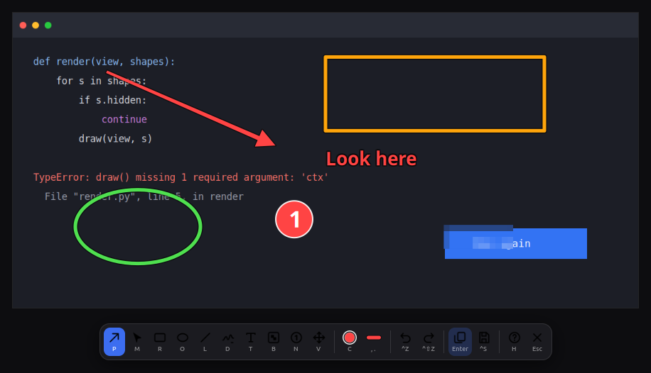
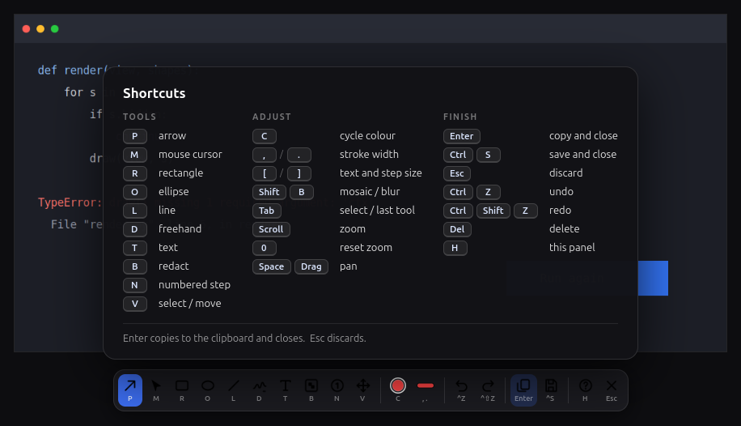

# Quickshot

Press **Super+Shift+S**. Select a region with GNOME's own screenshot overlay.
The editor opens with your capture. Draw an arrow, press **Enter**, and paste.

The image is on your clipboard and the editor is gone. It is built for the
"snap, point at the thing, paste it into a chat or an AI agent" loop.



## Requirements

- GNOME on Wayland (developed on GNOME Shell 50, Ubuntu)
- Python 3.10 or newer with GTK 4 bindings

```sh
sudo apt install python3-gi gir1.2-gtk-4.0 python3-cairo wl-clipboard xdg-desktop-portal-gnome
```

## Install

```sh
git clone https://github.com/AJ-505/quickshot
cd quickshot
./install.sh
```

No root needed. The installer:

1. copies Quickshot to `~/.local/share/quickshot` and the launchers to `~/.local/bin`
2. starts a small resident user service (`quickshot.service`), so the editor opens with no start-up delay
3. installs the **Quickshot Focus** GNOME Shell extension (see below)
4. binds **Super+Shift+S**. `Print` stays on GNOME's plain screenshot UI

**Log out and back in once after the first install.** GNOME only loads a new
shell extension at login.

Other hotkeys:

```sh
./install.sh '<Super><Shift>s' '<Ctrl><Alt>s'
```

Remove everything with `./uninstall.sh`. It restores your original GNOME
bindings, and it leaves your other custom shortcuts alone.

### Why a shell extension?

GNOME's focus-stealing prevention does not let a background service raise a
window. Without help, the editor opens *behind* the window you were using and
GNOME shows a "Quickshot is ready" banner. The extension has about 40 lines. It
raises one window only, the one with the application id `dev.quickshot.Quickshot`.
Source: [`shell-extension/extension.js`](shell-extension/extension.js).

## Keys

Every action has one key. The toolbar shows each key under its button, and
**H** opens the full cheat sheet.



### Tools

| Key | Tool |
|-----|------|
| `P` | Arrow (default) |
| `M` | Mouse cursor glyph (click to place) |
| `R` | Rectangle |
| `O` | Ellipse |
| `L` | Line (hold `Shift` to snap to 45°) |
| `D` | Freehand |
| `T` | Text (type in place, `Enter` to place, `Esc` to cancel) |
| `B` | Redact (mosaic; `Shift+B` switches to blur) |
| `N` | Numbered step (counts up, renumbers when you move one) |
| `V` | Select and move |
| `Tab` | Switch between select and the last drawing tool |

### Adjust

| Key | Action |
|-----|--------|
| `C` / `Shift+C` | Next / previous colour |
| `,` `.` | Thinner / thicker stroke |
| `[` `]` | Smaller / larger text and steps |
| wheel, `+` `-` | Zoom at the pointer |
| `0` | Reset zoom |
| `Space`+drag, middle-drag, right-drag | Pan |
| arrows | Nudge the selection (`Shift` for 10 px) |
| `Delete` | Remove the selection |

### Finish

| Key | Action |
|-----|--------|
| `Enter` | **Copy to the clipboard and close** |
| `Ctrl+S` | Save to `~/Pictures/Screenshots` and close |
| `Esc` | Discard and close |
| `Ctrl+Z` / `Ctrl+Shift+Z` | Undo / redo |

## Troubleshooting

```sh
quickshot --status                          # what the service thinks it is doing
journalctl --user -u quickshot.service -n 50 # service log, includes capture-to-editor latency
```

| Symptom | Cause |
|---------|-------|
| Editor opens behind other windows, "Quickshot is ready" banner | The focus extension is not loaded yet. Log out and back in. Check with `gnome-extensions info quickshot-focus@aj-505.github.io`. |
| Nothing happens on Super+Shift+S | Run `quickshot` in a terminal. If that works, the binding is missing: run `./install.sh` again. |
| The editor is blurry | Report it with your monitor scale. Captures should show at native pixels. |

## How it works

- **The portal is the capture.** Quickshot asks `org.freedesktop.portal.Screenshot`
  for an interactive capture. On GNOME this is the same overlay that `Print`
  shows, so selection works the way you already know.
- **A discarded shot leaves nothing behind.** The portal file moves into
  `~/.cache/quickshot` at once and is deleted when the editor closes.
- **The hotkey is a socket write.** `bin/quickshot` is a shell script that wakes
  the resident service over a Unix socket, which takes about 13 ms. Starting
  Python would take about 300 ms. The editor window is built once at login.
  Measured from portal answer to visible editor: about 60 ms for a 1280x800
  capture and 0.4 to 0.9 s for 4K.
- **Native pixels.** On a fractionally scaled monitor (for example 125%), the
  capture is shown 1:1 with physical pixels, so text stays sharp.
- **Redaction destroys detail.** It box-averages through GdkPixbuf. Cairo's
  downscale filters point-sample and can leave thin text legible.
- **Clipboard through `wl-copy`**, with GDK as the fallback. Override with
  `QUICKSHOT_CLIPBOARD=gdk`.

## Layout

```
bin/quickshot          hotkey target: wakes the service over a Unix socket
bin/quickshot-py       fallback launcher, starts the service if it is not running
bin/quickshotd         resident service entry point
src/quickshot/
  service.py           service: control socket, capture lifecycle
  capture.py           portal client
  editor.py            editor window, input, keymap, commit actions
  model.py             shapes, undo and redo
  render.py            cairo drawing and redaction
  toolbar.py           toolbar
  imageio.py           PNG, clipboard, save
  bind.py              GNOME keybinding install and uninstall
  style.py, icons.py   CSS and inline SVG icons
shell-extension/       Quickshot Focus GNOME Shell extension
data/                  desktop entry (gives notifications a proper name)
tools/preview.py       open the editor on any PNG, no portal needed
tools/snap_editor.py   render the editor to a PNG without showing it to you
tools/keyprobe.py      report which keys your keyboard really sends
tests/                 run with ./tests/run_all.sh (needs a GNOME session) or ./tests/run_ci.sh
```

## Development

See [CONTRIBUTING.md](CONTRIBUTING.md). Short version:

```sh
./tests/run_all.sh                      # full suite, needs a GNOME Wayland session
python3 tools/preview.py some.png       # open the editor on an image
ruff check .
```

The full suite writes to your clipboard during the clipboard tests.

## License

MIT. See [LICENSE](LICENSE).
